# Vistaar — Local Roots. Global Reach.

> Empowering Indian artisans and small businesses to explore, prepare for, and expand into international markets with AI-powered global expansion tools.

**Vistaar** is an AI-powered global expansion copilot designed to help local Indian businesses discover international market opportunities, localize products for foreign audiences, calculate export-oriented pricing, understand export readiness, and create localized global storefronts.

🌐 **Live Demo:** https://vistaarworld.in  
💻 **GitHub Repository:** https://github.com/Pratiksha-Andhare-PA/vistaar

---

## Table of Contents

- [Overview](#overview)
- [Problem Statement](#problem-statement)
- [Our Solution](#our-solution)
- [Key Features](#key-features)
- [How Vistaar Works](#how-vistaar-works)
- [System Architecture](#system-architecture)
- [Database Design](#database-design)
- [Technology Stack](#technology-stack)
- [AI Integration and Cost Management](#ai-integration-and-cost-management)
- [Deployment](#deployment)
- [Local Development Setup](#local-development-setup)
- [Limitations](#limitations)
- [Future Scope](#future-scope)
- [Hackathon](#hackathon)

---

## Overview

Many Indian artisans, makers, and small businesses have products with international potential but lack access to the tools, knowledge, and resources needed to expand beyond domestic markets.

Vistaar brings important global expansion workflows into one workspace, helping businesses make informed decisions about taking their products beyond borders.

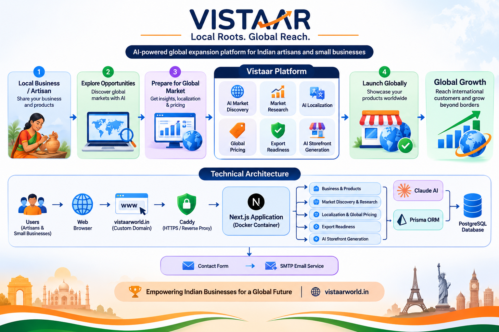

---

## Problem Statement

Small businesses and artisan groups face several challenges when exploring international expansion:

- Identifying suitable foreign markets for their products
- Understanding international demand and competition
- Adapting product descriptions and messaging to different cultures
- Estimating international selling prices and logistics costs
- Understanding export requirements and documentation
- Establishing an online presence for international customers

These tasks often require expensive consultants, fragmented tools, and specialized knowledge that smaller businesses may not have access to.

---

## Our Solution

Vistaar provides a unified platform to support the global expansion journey.

Businesses can:

1. Create a business profile.
2. Add products to their catalogue.
3. Explore international markets using AI-powered research.
4. Localize product content for target countries.
5. Calculate cost-based international pricing.
6. Generate product-specific export readiness checklists.
7. Create and publish localized storefronts.

The goal is to make international expansion more accessible, structured, and understandable for small businesses.

---

## Key Features

### 1. Business Onboarding

Create a business profile with business details, category, location, and contact information.

<p align="center">
  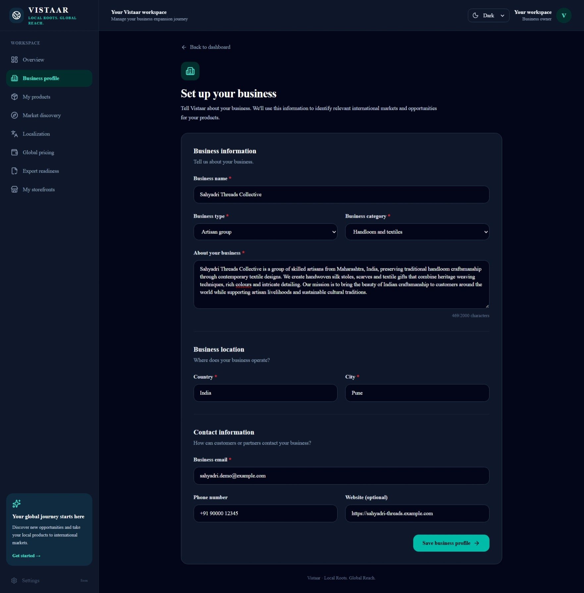
</p>

<p align="center">
  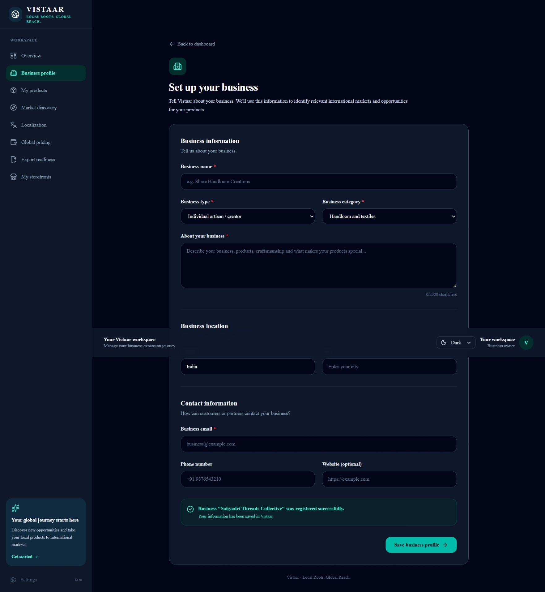
</p>

---

### 2. Product Catalogue

Add and manage products with descriptions, images, prices, and currencies. Maintain a catalogue that can be used throughout the international expansion workflow.

<p align="center">
  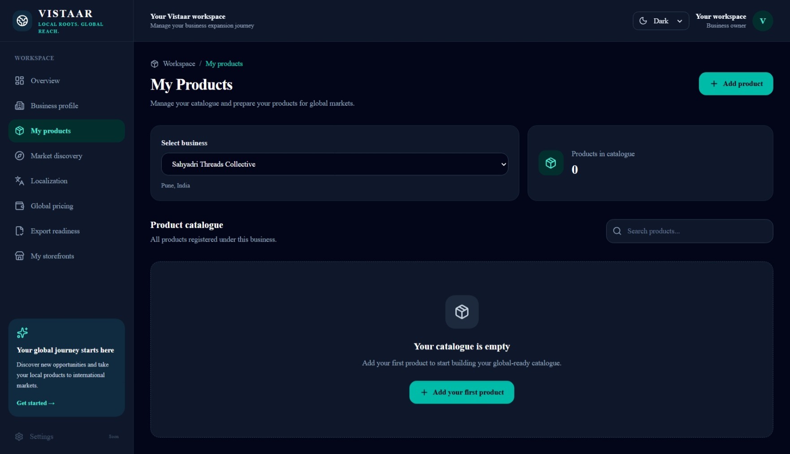
</p>

<p align="center">
  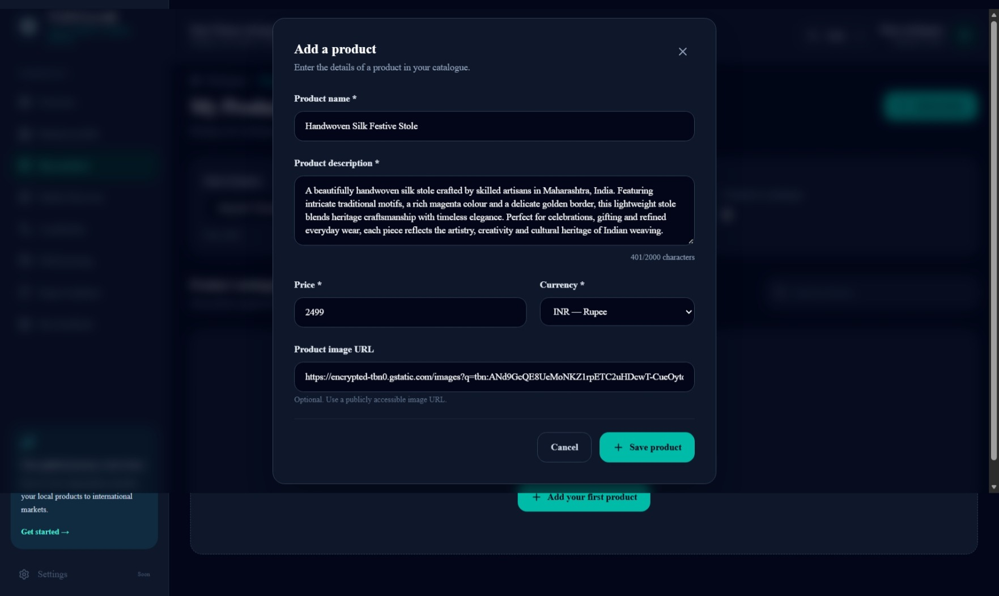
</p>

<p align="center">
  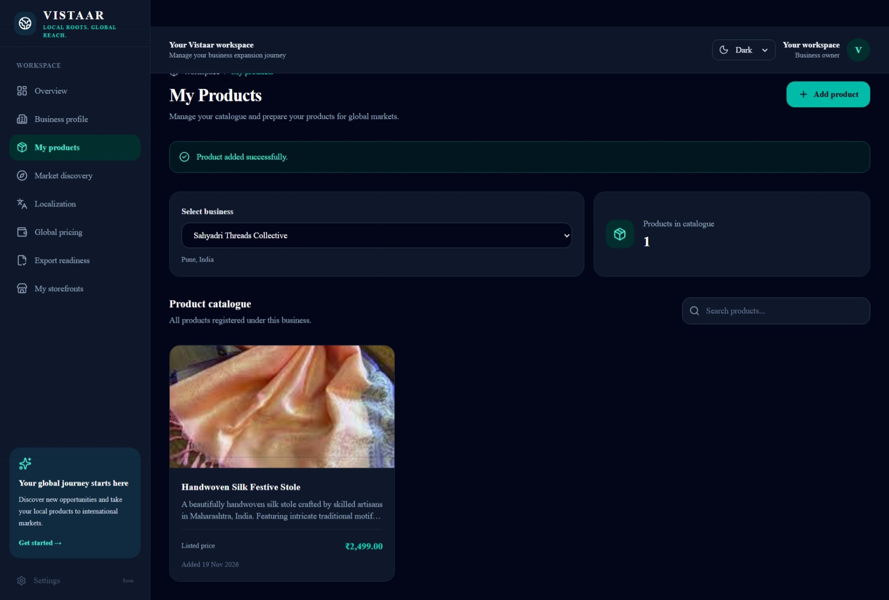
</p>

---

### 3. AI-Powered Market Discovery

Explore potential international markets for your products.

Market research helps businesses investigate opportunities across countries and compare market suitability using available market insights, demand indicators, competition, and other research factors.

<p align="center">
  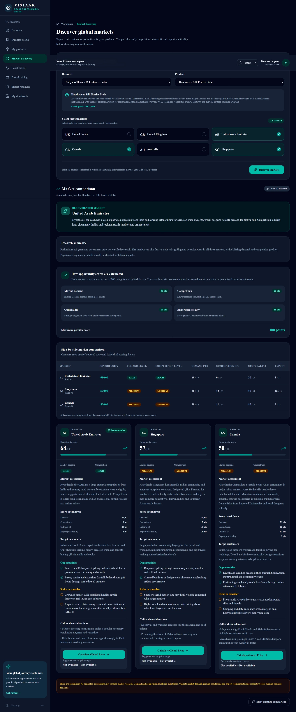
</p>

---

### 4. Cultural Localization

Adapt product descriptions, messaging, and content for target international markets.

Localization considers the selected target market and language while helping preserve the product's original identity and cultural context.

<p align="center">
  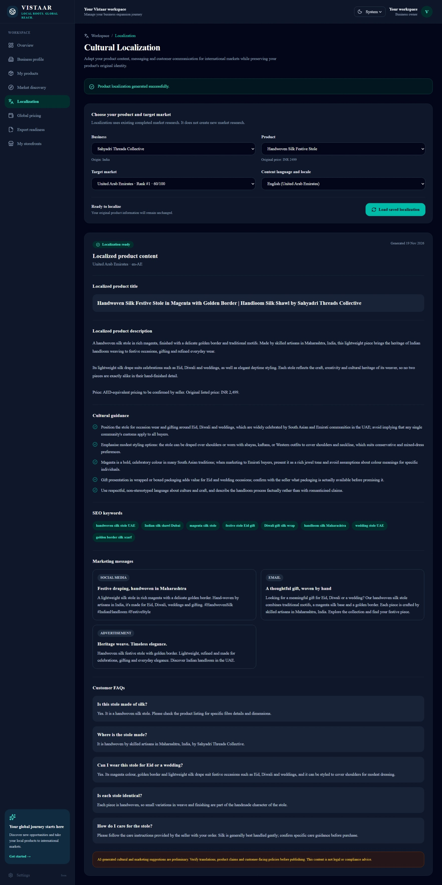
</p>

---

### 5. Global Pricing

Build international selling price scenarios using product and logistics costs, currency conversion, fees, estimated taxes and duties, and desired profit margins.

Pricing assumptions can be saved for reuse in localized storefronts.

<p align="center">
  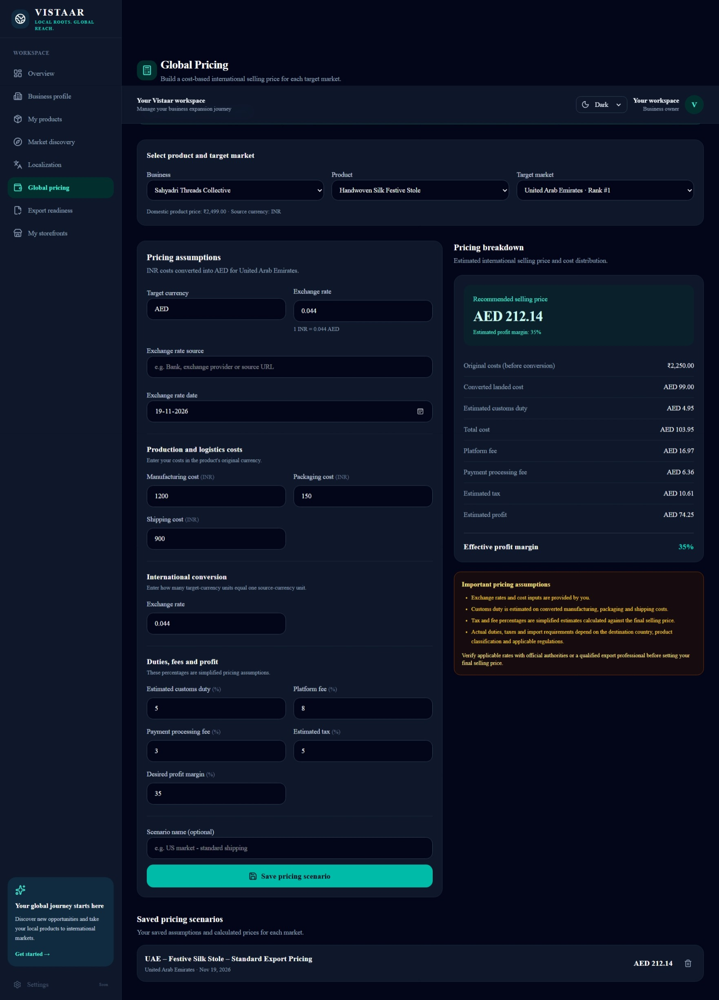
</p>

---

### 6. Export Readiness

Generate product- and market-oriented export preparation checklists to help businesses understand the steps involved in preparing for international trade.

<p align="center">
  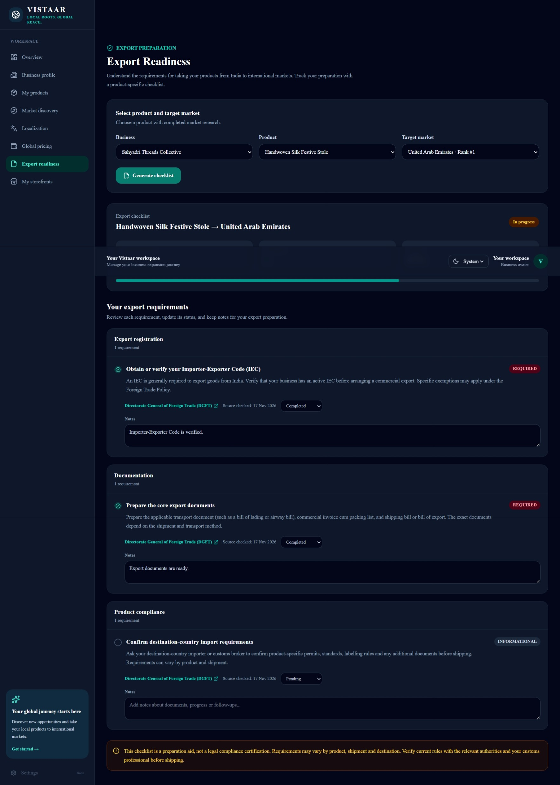
</p>

---

### 7. AI-Powered Global Storefronts

Create localized storefronts using product information, localization content, and saved international pricing scenarios.

Storefronts support a workflow from draft creation and review to publishing and viewing the live page.

<p align="center">
  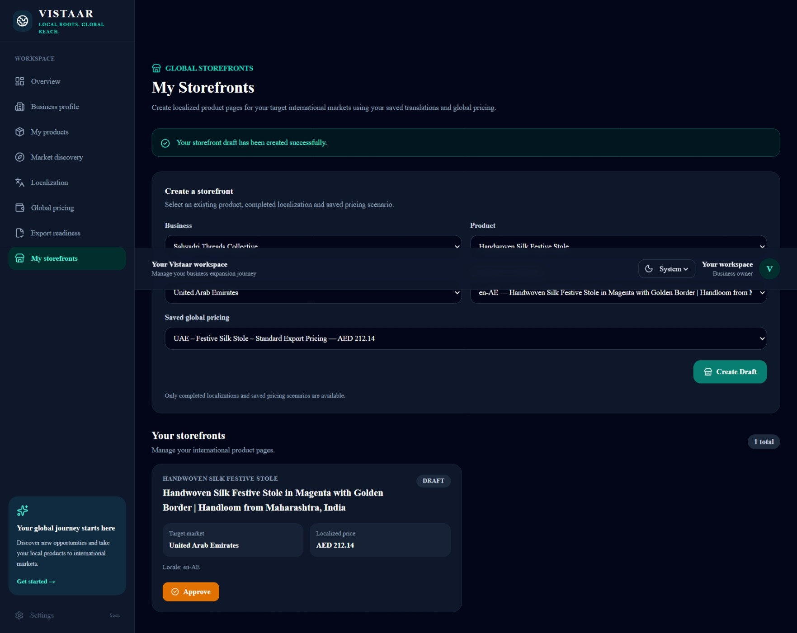
</p>

<p align="center">
  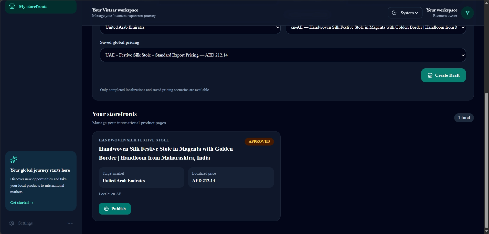
</p>

<p align="center">
  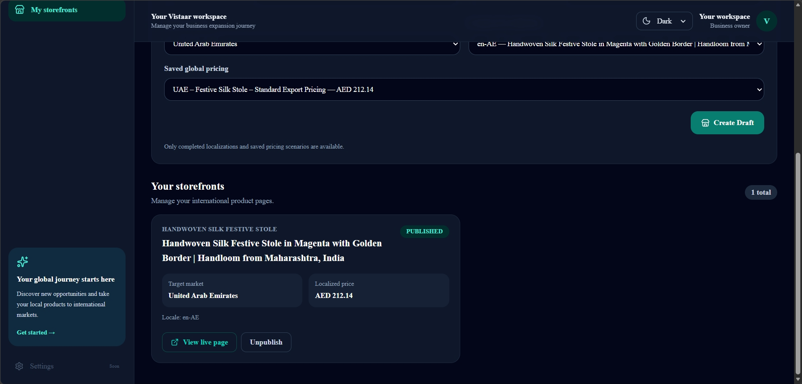
</p>

<p align="center">
  
</p>

---

## How Vistaar Works

The global expansion workflow follows these steps:

<p align="center">
  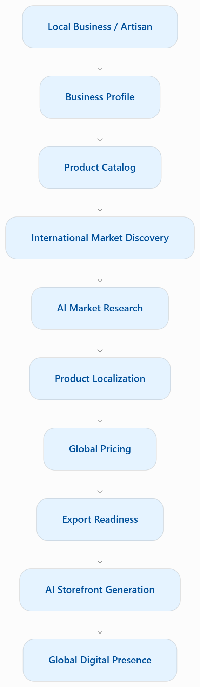
</p>

**Business → Products → Market Discovery → Localization → Pricing → Export Readiness → Storefront**

Each module builds on the information created in earlier steps, helping businesses follow a structured international expansion journey.

---

## System Architecture

Vistaar uses a web application architecture with a Next.js application, server-side application logic, a relational database, and AI integration.

<p align="center">
  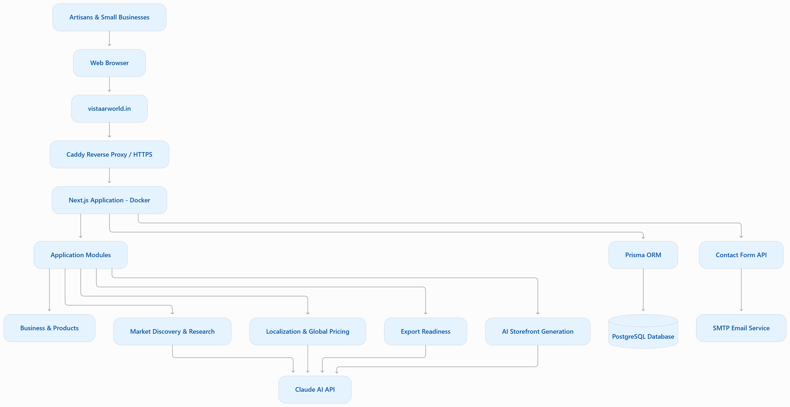
</p>

The application connects its frontend workflows with backend API routes, business logic, database persistence, and AI-powered capabilities.

---

## Database Design

Vistaar uses PostgreSQL with Prisma ORM for relational data management.

The database supports business profiles, products, market research, localization, pricing scenarios, storefronts, export readiness, and AI usage tracking.

<p align="center">
  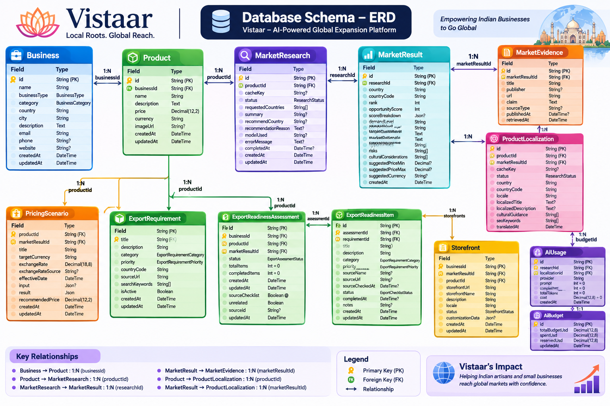
</p>

Major data entities include:

- Business
- Product
- MarketResearch
- MarketResult
- MarketEvidence
- ProductLocalization
- PricingScenario
- Storefront
- ExportReadinessAssessment
- ExportReadinessItem
- ExportRequirement
- AiBudget
- AiBudgetReservation
- AiUsage

---

## Technology Stack

| Category | Technology |
|---|---|
| Frontend & application framework | Next.js |
| UI development | React |
| Programming language | TypeScript |
| Database | PostgreSQL 17 |
| ORM | Prisma |
| AI integration | Anthropic Claude API |
| Containerization | Docker |
| Production server | GoDaddy VPS |
| Reverse proxy & HTTPS | Caddy |

---

## AI Integration and Cost Management

Vistaar uses AI to support workflows such as market discovery, cultural localization, and international expansion insights.

AI usage is managed with cost-conscious practices, including:

- Usage tracking
- Token-based cost estimation
- Budget monitoring
- Reservation and settlement mechanisms for AI operations
- Reuse of completed research where applicable
- Controlled AI calls to reduce unnecessary expenditure

The project was developed with a fixed AI API budget, making cost-aware implementation an important consideration.

---

## Deployment

Vistaar is deployed on a GoDaddy VPS.

### Production infrastructure

- Ubuntu 24.04 VPS
- Docker-based application deployment
- PostgreSQL 17
- Next.js application
- Caddy reverse proxy
- HTTPS-enabled custom domain

🌐 **Live application:** https://vistaarworld.in

---

## Local Development Setup

### Prerequisites

- Node.js and npm
- Docker
- Git
- PostgreSQL (or the project's Docker database configuration)

### 1. Clone the repository

```bash
git clone https://github.com/Pratiksha-Andhare-PA/vistaar.git
cd vistaar
```

### 2. Install dependencies

```bash
npm install
```

### 3. Configure environment variables

Create your local environment file using the project's environment template, if available.

Configure the required values for:

- Database connection
- AI API access
- Application configuration

Never commit API keys, SMTP credentials, or production environment files.

### 4. Start the database

Start PostgreSQL using the project's Docker Compose configuration.

### 5. Apply database migrations

```bash
npx prisma migrate deploy
```

### 6. Start the development server

```bash
npm run dev
```

Open [http://localhost:3000](http://localhost:3000) to access Vistaar.

> Refer to the repository's Docker Compose files and environment configuration for the exact database startup requirements.

---

## Limitations

- AI-generated market insights should be validated against reliable sources before making business decisions.
- Pricing scenarios are estimates and depend on user-provided cost inputs, currency conversion assumptions, duties, fees, and taxes.
- Export readiness checklists are informational and do not replace professional export, customs, legal, or tax advice.
- Market conditions, regulations, and exchange rates can change.
- The current application is a hackathon prototype and is not a substitute for a complete export compliance or enterprise commerce platform.

---

## Future Scope

Potential improvements include:

- Verified market data sources and deeper market intelligence
- More comprehensive export compliance information
- Integration with logistics and shipping providers
- Multi-user accounts and authentication
- Business analytics and expansion tracking
- More languages and regional localization
- Direct integration with international e-commerce platforms
- Advanced competitor and demand analysis

---

## Hackathon

Built for the **GoDaddy Inclusive Innovation Challenge 2026** under the **Open Innovation** theme.

Vistaar aims to make global opportunities more accessible to India's artisans, makers, and small businesses.

### Local Roots. Global Reach.
